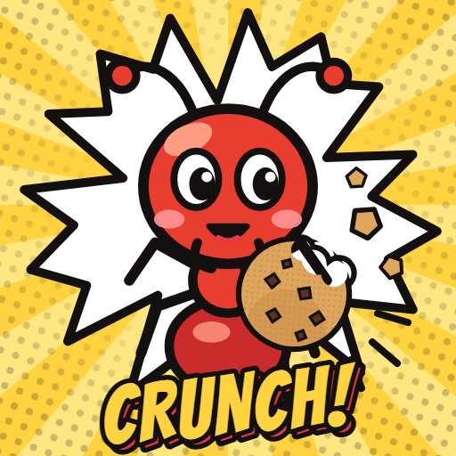
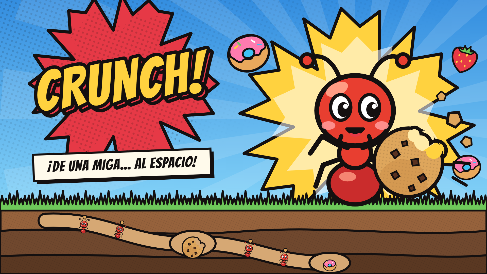
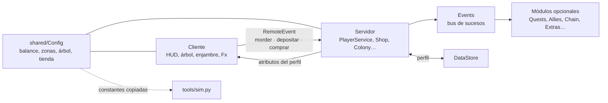

<div align="center">



# CRUNCH!

Incremental de hormigas para Roblox, en cómic a color: de una miga por viaje a un enjambre que se come el espacio.

[](https://create.roblox.com/)
[](https://luau.org/)
[](https://rojo.space/)
[](tools/sim.py)
[](#zonas)

<br />

[El juego](#el-juego) · [Zonas](#zonas) · [Stack](#stack) · [Funcionamiento](#funcionamiento) · [Desarrollo](#desarrollo-local) · [Balance](#balance) · [Publicar](#pendiente-de-configurar-en-roblox)

</div>

---



CRUNCH! empieza contigo sola, una hormiga que muerde una miga y la lleva a casa. Excavas tu hormiguero capa a capa y cada capa te abre un sitio nuevo por el camino: del jardín al picnic, el huerto, la jungla, la playa, la barbacoa, la cocina, la despensa, la nevera, el cuarto de juguetes, el escritorio, la feria, Dulcelandia y el espacio, donde espera la Tarta. Por el camino compras obreras, mandíbulas, alas y aliadas, hasta que la colonia desmonta un banquete en segundos.

Todo el juego **se construye por código** al arrancar el servidor: mapa, luz, hormigueros, comida, decorado y la hormiga. El lugar de Studio puede estar vacío. La economía la manda el servidor; el cliente solo pide acciones y dibuja. Los números viven en una sola tabla (`Config`) y un simulador en Python juega el bucle real antes de tocarlos. El diseño completo está en [DISENO.md](DISENO.md).

## El juego

| | |
| --- | --- |
| **Morder y cargar** | Cada comida tiene vida y se desmonta a mordiscos. Mordisco cargado, doble mandíbula, mordida en cadena (un rayo que salta a las vecinas del racimo) y comida dorada que vale x5. |
| **El hormiguero** | Árbol de mejoras en corte, como una viñeta larga: cuatro pozos (Mandíbulas, Patas, Colonia, Feromonas) más la rama de Aliadas, 46 cámaras grandes y 504 galerías pequeñas. «Comprar lo barato» gasta media despensa de golpe. |
| **La colonia** | Obreras que repiten tu ruta, rastros de feromonas, órdenes y hasta tres escuadrones (lo más cercano, lo más rico, rematar, a por la grande…). |
| **Aliadas** | Abeja mensajera, imán, escarabajo de carga, escolta, pisotón, tirachinas, lupa y mega crunch. |
| **Castas** | Roles con su experiencia, sus mutaciones y tres habilidades cada uno. |
| **Moverse** | Sprint, alas de ida y vuelta, túnel exprés con salida a cada zona abierta y sendas de feromonas que te aceleran. |
| **Jardín vivo** | La comida crece con la gente conectada; cada pocos minutos pasa algo (mariposa con regalo, hora feliz, pan gigante), con setas saltarinas y dientes de león para soplar. |
| **Vecinas** | Jardín compartido para 6, sin que nadie pierda progreso: despensas que se pueden asaltar a mordiscos, emotes con combo y un cartel mundial con las diez mejores. |
| **Enjambrar** | Prestigio: la partida se convierte en Jalea Real para el Árbol Real. Comerse la Tarta duplica la jalea. |
| **Tu hormiga** | Cambia con lo que compras (mandíbulas, pinchos, alas, armadura, tamaño) y con el vestidor (colores, sombreros, estelas). El montículo crece, gana banderas y corona. |
| **Primeros pasos** | Seis metas cortas con fiesta y premio, y las primeras 30 migas valen el doble. |

## Zonas

Una por capa del hormiguero, en este orden por el camino (`Config.Zones` y `FOOD_LIST`; la comida en cursiva es dura):

| Capa | Zona (tema) | Comidas |
|---|---|---|
| 1 | Jardín | Miga, Pipa, Arándano |
| 2 | Picnic | Galleta, Sándwich, *Manzana* |
| 3 | Huerto | Fresa, Tomate, *Zanahoria* |
| 4 | Jungla | Uvas, Plátano, *Coco* |
| 5 | Playa (`Mar`) | Patatas fritas, Helado, *Sandía* |
| 6 | Barbacoa | Mazorca asada, Brocheta, *Costillas* |
| 7 | Cocina | Cubo de azúcar, Huevo frito, Queso |
| 8 | Despensa | Cereales, Pan de molde, *Tarro de miel* |
| 9 | Nevera | Yogur, Sushi, *Lata de refresco* |
| 10 | Cuarto de juguetes (`Juguetes`) | Ganchitos, Zumo, *Huevo sorpresa* |
| 11 | Escritorio | Cruasán, Barrita de cereales, *Nuez* |
| 12 | Feria | Palomitas, Perrito caliente, Hamburguesa |
| 13 | Dulcelandia (`Dulce`) | Donut, Magdalena, *Chocolate* |
| 14 | Espacio | Gominola, Pizza, Tarta (jefa) |

La comida sale en racimos (`Config.FoodLayout`, `FoodService`): en cada zona del camino, 52 comidas en ocho racimos de 4 a 16 casi tocándose (migas, mixtos con una grande rodeada de pequeñas, medianas y un banquete con la jefa de la zona, una grande con cuatro veces su vida), con pasillos libres entre ellos. Cada comida vuelve a su sitio del racimo. Las zonas miden 190 de ancho por 230 de largo (`Config.Map`).

Para añadir una zona: su entrada en `Config.Zones` y `Config.Layers`, tres comidas en `FOOD_LIST` con su constructor en `FoodModels`, su decorado en un módulo `Decor*` (con `Themes`), su ambiente en `Ambience` y `Places`, y las listas de `tools/sim.py`. Los peligros (`Hazards`) buscan su zona por tema, no por número.

## Stack

| Capa | Tecnología | Uso |
| --- | --- | --- |
| Juego | Roblox, Luau | Servidor autoritativo, cliente y módulos compartidos (unas 54.000 líneas en 107 archivos) |
| Sincronización | Rojo (`default.project.json`) | `src/shared` → ReplicatedStorage, `src/server` → ServerScriptService, `src/client` → StarterPlayerScripts |
| Guardado | DataStoreService | Carga con reintentos; guarda al salir, cada minuto y al cerrar el servidor |
| Red | `RemoteEvent` en `ReplicatedStorage.Remotes` | El cliente pide (morder, depositar, comprar); el servidor valida distancia, enfriamiento y saldo |
| Enjambre | `workspace:BulkMoveTo` | Las obreras son números en el servidor; cada cliente dibuja hasta unas 300, sin Humanoid |
| Monetización | MarketplaceService | Pases permanentes y productos de un uso (`Config.Passes`, `Config.Products`) |
| Balance | Python (`tools/sim.py`) | Simula el bucle real, viaje a viaje, para tres perfiles de jugadora |
| Arte | Python (`art/gen_art.py`), HTML (`art/promo`) | Trama, cielo, viñeta, iconos del árbol, icono y miniatura del juego |

## Funcionamiento



- **El servidor manda.** Toda la economía se calcula allí. `Profiles` guarda el estado en memoria y lo refleja en atributos del jugador, que es lo que lee el cliente.
- **Bus de sucesos.** `Events` emite comer, terminar, entregar, comprar, excavar, enjambrar y bocado dorado. Misiones, cadena, ventajas de las galerías y demás escuchan sin tocar el bucle por dentro.
- **Módulos opcionales.** `init.server.luau` arranca `Quests`, `WorldEvents`, `PetService`, `Hazards`, `Allies`, `GoldFood`, `Chain`, `Tunnel`, `Extras`, castas y demás solo si existen. Si uno falta, el juego sigue igual.
- **Un solo `Config`.** Zonas, comidas, árbol, tienda, textos y balance viven en `src/shared/Config.luau`; `Stats.derive` saca de ahí las cifras de la hormiga, las mismas que imprime el simulador.
- **Sin streaming.** `Workspace.StreamingEnabled` debe estar apagado: el mapa es pequeño y los clientes dibujan las obreras a partir de los hormigueros, que tienen que estar siempre cargados.

## Desarrollo local

### Requisitos

- Roblox Studio.
- [Rojo](https://rojo.space/) (con Rokit o Aftman) y su plugin en Studio.
- Python 3 para el simulador y el arte (`art/gen_art.py` usa Pillow).
- Opcional: VS Code con Luau LSP, y el servidor MCP de Roblox Studio para que un agente vea y toque el lugar abierto.

### Arrancar

1. Abre el lugar en Roblox Studio.
2. En una terminal, dentro de esta carpeta:

   ```bash
   rojo serve
   ```

3. En Studio: pestaña **Plugins** → **Rojo** → **Connect**.
4. Pulsa **Play**.

### Controles

| Acción | Teclado | Táctil |
|---|---|---|
| Morder | mantener clic o `E` | mantener pulsado |
| Hormiguero (árbol de mejoras) | `Q` | botón Hormiguero |
| Vestidor | `V` | botón Vestidor |
| Coger el huevo dorado o un hongo maduro (junto a tu hormiguero) | pisarlo | pisarlo |
| Rastro, sprint, alas, frenesí, pisotón, tirachinas | `F`, `Shift`, `R`, `G`, `X`, `C` | botones a la derecha |
| Túnel exprés (junto a tu agujero o a una salida) | mantener `B` (mando: `B`) | tocar el aviso |
| Lluvia propia | `L` | botón Lluvia |
| Mordisco cargado | dejar de morder junto a la comida y volver a morder | igual |

### Herramientas de Studio

**Datos de prueba.** En Studio, las partidas y el ranking se guardan en `CrunchSave_v3_studio` y `CrunchTop_v3_studio`, nunca en los del juego publicado. Lo que pruebes en Studio no toca partidas reales.

**Panel DEV.** Con el juego en Play en Studio, botón **DEV** (abajo a la izquierda) o tecla **F2**. Fuera de Studio no existe.

| Pestaña | Qué hace |
|---|---|
| Partida | Preparar una capa (1-14) con el árbol y las galerías al tope, desde una partida limpia; dar comida, jalea y enjambres; reiniciar la partida; dar cualquier pase o producto |
| Eventos | Lanzar ya cada evento (sale con su aviso normal; si ya hay uno en curso, lo dice) |
| Viaje | Ir a casa o a la entrada de cualquier zona |

El panel se actualiza solo: las capas, zonas, pases y productos salen de `Config`. Para que un **evento nuevo** aparezca en la pestaña Eventos, su módulo de servidor lo registra al arrancar:

```lua
local DevTools = require(script.Parent.DevTools)
DevTools.register("id", "Nombre en el panel", function(profile)
	-- lanzar el evento para quien pulsa; devolver el texto que verá el panel
	return "Listo"
end)
```

**Barra de comandos.** Con el juego en Play, en vista de servidor (aplica a todos los jugadores):

```lua
local d = game.ServerScriptService.CrunchDebug
d:Fire("food", 5000)        -- dar comida
d:Fire("depth", 4)          -- fijar la capa excavada
d:Fire("max", 4)            -- todo el árbol al tope de la capa 4
d:Fire("minis")             -- todas las galerías de las capas ya excavadas
d:Fire("node", "bite", 6)   -- fijar el nivel de un nodo
d:Fire("workers", 20)       -- fijar obreras
d:Fire("jelly", 10)         -- fijar jalea
d:Fire("rebirths", 3)       -- fijar enjambres (banderas y corona)
d:Fire("tarta")             -- marcar la tarta como comida
d:Fire("grant", "vip")      -- entregar un pase o producto por su id de Config
```

## Balance

Todo está en `src/shared/Config.luau`. La curva entera se mueve con pocos números:

- `Config.FoodCurve`: vida de cada comida (mordiscos que debe costar con la mordida de su capa: 6, 18 y 56 a media capa) y valor de cada zona (`ZoneValues`).
- `Config.Player` (`BitePower`, `BiteSplit`, `CarryGrowth`, `MinLoadBites`) y `Config.Milestones`: la mordida, la carga y sus hitos.
- `Config.StageGrowth` y `Config.DigBase`: cuánto más cuesta cada capa.
- `Config.CostScale`: abarata o encarece todo el árbol de golpe.

Antes de tocarlos, mira el efecto:

```bash
python tools/sim.py
```

```bash
python tools/sim.py --audit
```

El simulador juega el bucle de verdad, viaje a viaje: ir hasta los racimos de una zona andando y corriendo, morder con su enfriamiento, cadena y área dentro del racimo, llenarse y volver, con túnel, alas, abeja y puesto avanzado. Suma la colonia con sus topes (una comida no cae en menos de 3 s; ninguna zona da más de lo que rebrota) y el resto de ingresos, para tres perfiles: **activo** (85 % del tiempo jugando a mano), **casual** (45 %) y **ausente** (10 %).

Por capa imprime minutos, compras, espera más larga entre compras, reparto del ingreso (mano, colonia, ayudantes, extras, misiones, castas y social) y mordiscos por comida y por viaje, y termina con una lista APROBADO/FALLA de los objetivos de ritmo (`--detalle` la enseña entera). `--audit` añade cuánto sube el ingreso cada mejora al comprarla por primera vez y su retorno.

| Hito (perfil activo) | Tiempo |
| --- | --- |
| Primera compra | pocos segundos |
| Primera obrera | ~3 min |
| Capa 2 | ~9 min |
| Cada capa después | ~30 min |
| Capa 14 | ~6 h |

Casual tarda entre 1,6 y 2 veces más. La velocidad al andar tiene techo (`Config.Player.MaxWalk`, 45) y lo que las mejoras den de más se vuelve comida; igual con lo que arrancan a las vecinas área, cadena, doble mandíbula, escolta y mega crunch (`NeighborCap`).

Casi todo se puede probar sin tocar el archivo: `SIN=bee,lens python tools/sim.py` simula sin esas mejoras y `BITE_POWER=1.3 python tools/sim.py` cambia una constante. Es una simulación, no una prueba con jugadores, y `sim.py` copia las constantes de `Config`: si cambias unas, cambia las otras.

Las 504 galerías se generan solas desde `Config.MiniTune` (costos, cantidades por tipo y qué tipos salen en cada rama). Cuestan de 12 a 300 a escala de la capa para que siempre haya algo barato, y sus efectos son pequeños a propósito (las de mordida, carga y obreras dan un 8-15 % de lo que se tiene a media capa); si subes los porcentajes permanentes, las capas finales se aceleran mucho.

## Estructura

| Carpeta | Qué hay |
|---|---|
| `src/shared` | `Config` (balance, zonas, comidas, árbol, tienda y textos), `Stats` (fórmulas), `FoodModels`, `AntModel` y `AntLook` (cómo cambia la hormiga con las mejoras y la ropa), `Assets` (ids de imágenes, sonidos y música) |
| `src/server` | `World` (jardín, camino, puertas, hormiguero que crece y su cartel), `HillModel`, `Decor`, `Decor2` y `Decor3` (decorado por tema), `Nest` (huevo dorado y hongos), `FoodService`, `PlayerService` (morder, depositar), `Colony` y `Orders` (obreras, órdenes y escuadrones), `Shop` (compras, excavar, vestidor, enjambrar), `Events`, `Monetize`, `Leaderboard`, `Data`, `Profiles`, `DevTools` (panel DEV y `CrunchDebug`, solo en Studio) |
| `src/server`, opcionales | `Quests`, `WorldEvents`, `PetService`, `Hazards`, `Allies`, `GoldFood`, `Chain`, `Tunnel`, `Extras`, `Garden`, `Opening`, `Perks` (reglas de las galerías), `CasteService` y `Castes/`, `Social` (despensas y asaltos), `Stalls` (puestos del mapa), `Emotes` |
| `src/client` | `Tree` (árbol-hormiguero por capas), `Hud`, `Swarm` (dibujo de obreras), `Abilities`, `Places`, `Wardrobe`, `Store`, `Fx`, `Bubble`, `Sfx`, `Comic` (estilo), `State`, `Targeting`, `AntAnim`, `Chain`, `Tunnel` y la parte de cliente de cada módulo opcional (`Life`, `Ambience`, `Allies`, `Extras`…), `DevPanel` (el panel DEV, solo en Studio) |
| `art` | `gen_art.py` genera texturas e iconos en `art/out`; `promo/` tiene el icono y la miniatura del juego |
| `tools` | `sim.py`, el simulador de balance |

## Pendiente de configurar en Roblox

- **Guardado en Studio**: Configuración del juego → Seguridad → activar *Enable Studio Access to API Services*. Sin eso, en Studio se juega sin guardar y el cartel de puntuaciones solo muestra a los jugadores del servidor (en el juego publicado guarda siempre y el cartel es mundial).
- **Jugadores por servidor**: 6 como máximo. Hay 6 hormigueros.
- **Microtransacciones**: crea los pases y productos en el panel de creador (Monetización) y pega sus ids en `Config.Passes` y `Config.Products`. Cada uno trae un precio sugerido en `robux`. Con id `0` el artículo no aparece en el juego publicado; en Studio se listan todos para revisar la tienda.
- **Música**: `Assets.Music` es una lista de temas del catálogo libre de Roblox elegidos por búsqueda. Escúchalos y cambia los que no te gusten.

## Arte

```bash
python art/gen_art.py
```

Genera trama, cielo, viñeta, líneas de velocidad, estallido e iconos. Si cambias una imagen hay que volver a subirla a Roblox y actualizar su id en `src/shared/Assets.luau`. Varias mejoras del árbol reutilizan el icono de su familia (campo `icon` en `Config.Tree`). El icono y la miniatura salen de `art/promo/icon.html` y `art/promo/thumb.html`.

## Documentación

- [Documento de diseño](DISENO.md): bucle, árbol, enjambrar, números, estilo cómic y arquitectura.

## Aviso

Proyecto personal sin licencia pública definida. Título en Roblox: **CRUNCH! 🐜 [Ant Incremental]**.

<div align="center">
<br />
<sub>Hecho en Pereira, Colombia</sub>
</div>
